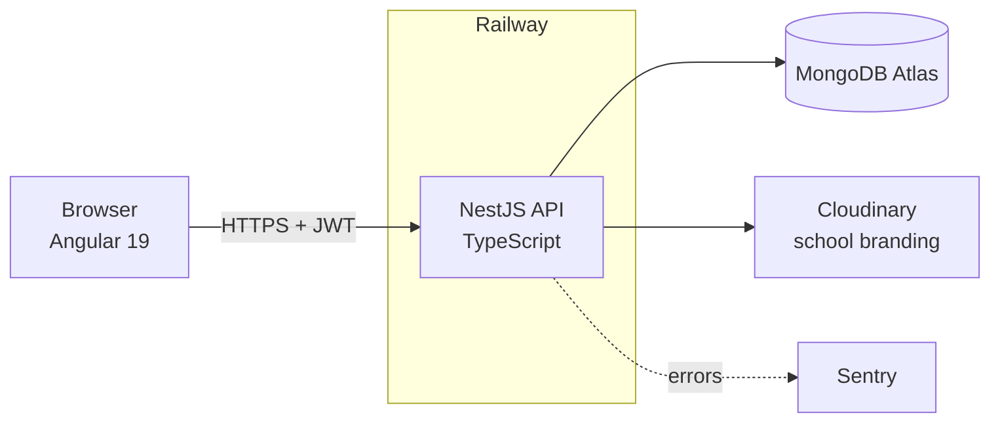
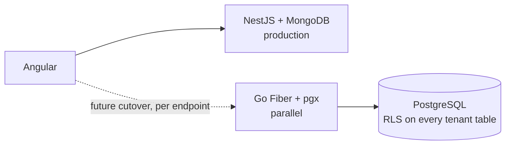

# Architecture

## 1. Production system today

- **Frontend:** Angular 19, standalone components, Signals, routes lazy-loaded per role zone.
- **Backend:** NestJS, one module per domain, Controller → Service. No separate repository layer.
- **Data:** MongoDB Atlas (replica set provided by the platform).
- **Hosting:** Railway. **Observability:** Sentry (production only) + structured logs (pino) with redaction of passwords, tokens and national IDs.

### Domain modules (summary)

| Module | Responsibility |
|---|---|
| auth | JWT login/registration; `AuthGuard` + `RolesGuard` reused everywhere |
| configuration | Per-school, per-year setup: cycles, periods, grades, subjects, grading rules, bilingual labels |
| grades | Grade entry; unique upsert per (school, student, subject, period, year); numeric, conceptual or hybrid + criteria |
| report card | Aggregates grades, criteria, students and configuration; visibility depends on role |
| assignments | Links teachers to grade/section/subject; defines which students a teacher may see |
| attendance / criteria | Attendance sheets (bilingual) and per-criteria evaluation |
| students / users | Profiles and accounts |
| schools | Per-school branding (logo, colors) |
| director / admin | Dashboards and administration for each role |
| audit log | Interceptor that records changes with field-level detail |
| health | Liveness/readiness endpoint |

## 2. Multi-tenant isolation

Every school ("tenant") shares one deployment and one database. Isolation rules:

1. The tenant id (`schoolId`) comes from the verified JWT, read through a dedicated `@SchoolId()` parameter decorator that rejects tokens without it; controllers do not take it from path or query parameters.
2. Every service query must include that filter. This is **enforced by convention and tests**, not by the database.
3. Looking up a resource that belongs to another school returns the same `404` as one that does not exist (anti-enumeration).

**Why this matters:** convention-based isolation is the weakest part of this design. A self-initiated audit found three
cases where the filter was missing (a password-change endpoint, a "my children" lookup, and a profile endpoint without an
auth guard). All three were fixed (together with three medium findings, e.g. a cross-tenant lookup path that was removed), and an integration suite
against a real in-memory MongoDB was added for the grades and attendance services to catch regressions
(including a check that the unique index on grades includes the tenant id).
That experience is the main driver of the PostgreSQL migration below.

## 3. Security controls

| Control | Detail |
|---|---|
| Authorization | Deny-by-default RBAC: a route without an explicit role list is rejected; roles come from the JWT |
| Passwords | bcrypt |
| Tokens | JWT, one-day lifetime |
| HTTP hardening | `helmet` security headers |
| CORS | Allowed origins loaded from the schools' active domains and reloaded every 5 minutes; the last valid list is kept if a reload fails |
| Rate limiting | Global throttler: 30 requests per minute per IP |
| Client IP | `trust proxy` configured for the hosting proxy (related to a patched `proxy-addr` CVE) |
| Health check | Terminus: database ping (returns 503 if it fails) and a heap-size check (reported as a warning) |
| Logging | Structured (pino) with redaction of passwords, tokens, national IDs and auth headers |
| Auditing | Interceptor-based audit log with field-level change detail |
| Error tracking | Sentry, production only |

## 4. Migration: Go + PostgreSQL with Row-Level Security (in progress)

Runs **in parallel**, with no production traffic, one domain at a time (strangler-fig pattern).

- **Goal:** tenant isolation **enforced by the database** instead of by code discipline.
- **RLS:** tenant tables carry a row-level-security policy that compares `school_id` with a session setting. The report-card domain opens a
  transaction per request and sets that value with a parameterized `set_config(..., true)`, scoped to the transaction so it cannot leak between
  requests that reuse a pooled connection. **Today this enforcement is wired into the report-card domain only**; other ported domains still filter by
  school in their queries. The policies live in the database but are not yet versioned in the repository's SQL migrations.
- **Authorization inside a tenant:** RLS does not separate users of the same school, so the role rules from the NestJS service were ported
  (admin/director unrestricted; student sees own data; teacher sees only assigned grade/section). The family role is blocked on purpose for the
  report card until the family ↔ student check is wired into that authorization.
- **Shared JWT:** both backends accept the same token; ids that are Mongo ObjectIds in NestJS are mapped to deterministic UUIDs for PostgreSQL.
- **Response shape:** identical to the NestJS API so the frontend does not need changes to switch an endpoint.

### How it was validated

- Real report-card data compared field by field between MongoDB and PostgreSQL (hash comparison on a sample of real students: 15/15 identical).
- Integration tests against a real PostgreSQL instance (no mocks): RLS isolation, role authorization, report-card contents.

> The pilot domain is the report card because it is read-only: it cannot corrupt grade entry or block anyone's login.
