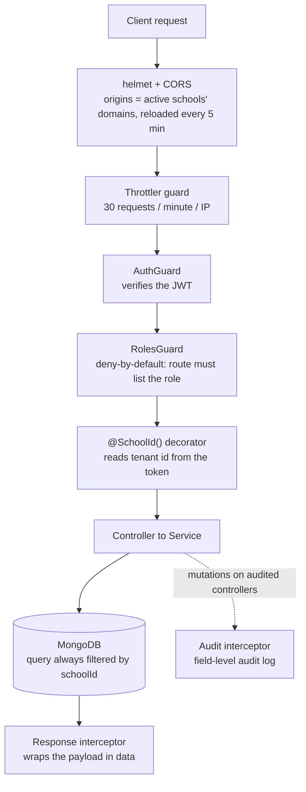
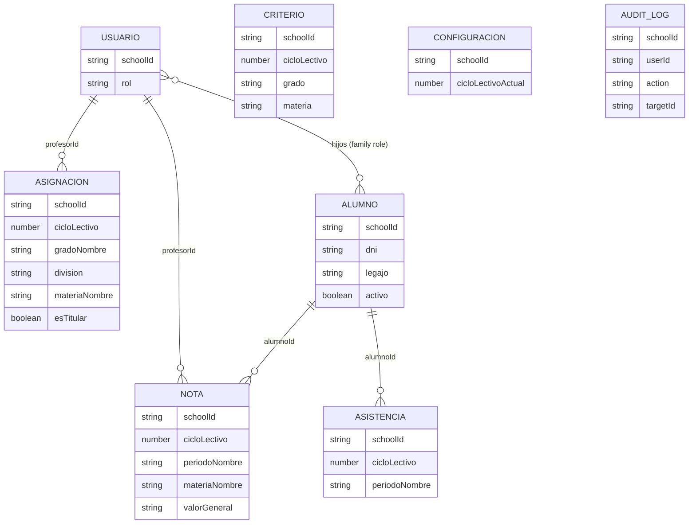
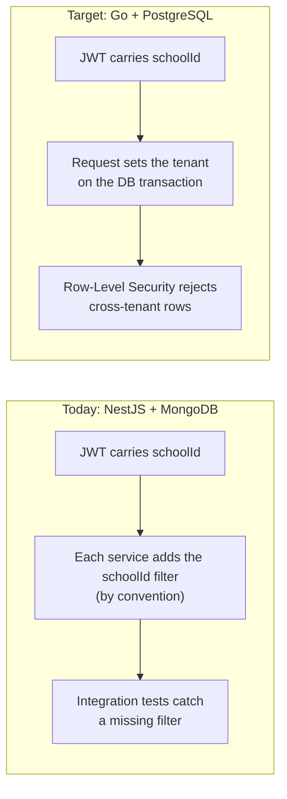
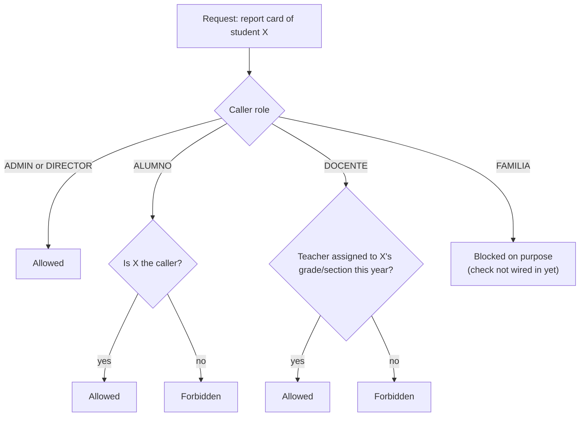
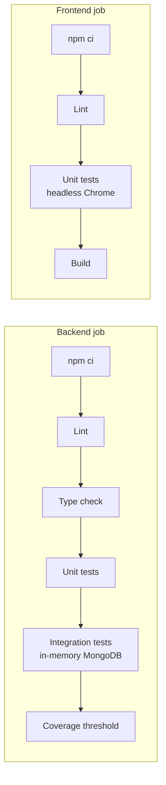
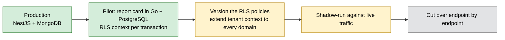

# Diagrams

All diagrams are based on the production code (NestJS backend, Angular frontend, CI workflow) and on the Go + PostgreSQL service. Simplified on purpose.

## 1. Request path (NestJS)

## 2. Data model (MongoDB, logical view)

Every collection carries `schoolId`: that is the tenant boundary.

Grades have a unique index on (schoolId, alumnoId, materiaNombre, periodoNombre, cicloLectivo), so the same student/subject/period in two schools never collides.

## 3. Tenant isolation: today vs. target

## 4. Report-card authorization (Go service)

## 5. CI pipeline

## 6. Migration phases (strangler fig)

Green: done. Yellow: next. Grey: later. The Go service does not serve production traffic yet.
