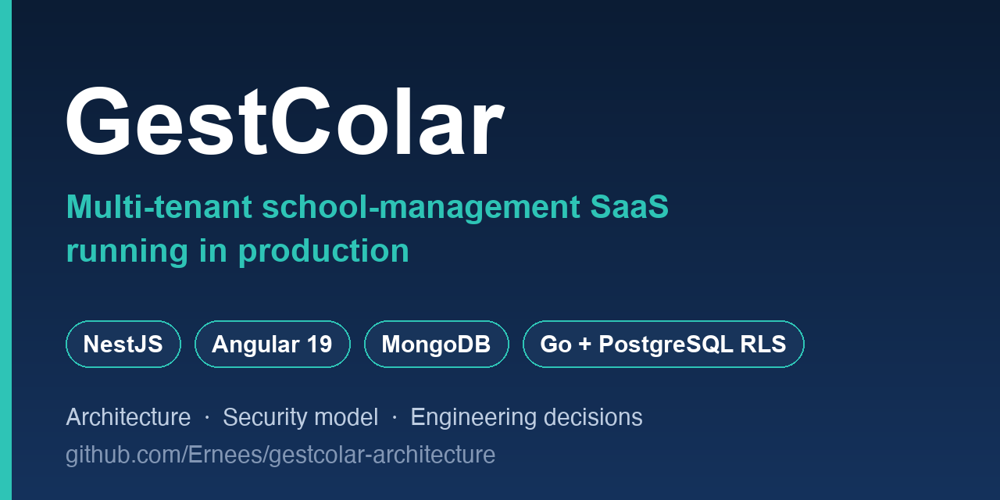

# GestColar — Architecture Overview

> Multi-tenant school-management SaaS, running in production with a real school.
> *Plataforma SaaS multi-tenant de gestión escolar, en producción con un colegio real.*

This repository documents the **architecture, security model and engineering decisions** behind GestColar.
The source code is private (it serves real students and families); nothing here contains real data.

## What it does

Manages the full academic cycle for Argentine schools (bilingual ES/EN): school-year setup, teacher assignments,
grading (numeric, conceptual or hybrid, with per-criteria evaluation), attendance and report-card generation.
One deployment serves several schools, each isolated from the others.

## At a glance

| | |
|---|---|
| Users | ~315 (286 students + teachers, principals, admins) |
| Roles | 5 flat roles: `ADMIN`, `DIRECTOR`, `DOCENTE`, `FAMILIA`, `ALUMNO` |
| Backend | NestJS + TypeScript, 14 controllers across domain modules (Controller → Service) |
| Frontend | Angular 19 (standalone components, Signals, lazy routes per role) |
| Data | MongoDB Atlas |
| Hosting / observability | Railway, Sentry, structured logs (pino, with redaction) |
| Tests / CI | 97 unit tests + 6 integration tests (real in-memory MongoDB, no mocks; cover grades and attendance isolation). CI runs lint, type-check, tests, integration tests and a coverage threshold for backend and frontend |
| In progress | Go (Fiber, pgx) + PostgreSQL with Row-Level Security, strangler-fig migration |

## Read next

- [ARCHITECTURE.md](./ARCHITECTURE.md) — components, tenant isolation, security controls, migration design
- [DIAGRAMS.md](./DIAGRAMS.md) — request path, data model, tenant isolation, authorization, CI, migration phases
- [DECISIONS.md](./DECISIONS.md) — the "why" behind the main trade-offs
- [ROADMAP.md](./ROADMAP.md) — known limitations and what comes next

## Highlights worth knowing

- **Self-initiated security audit:** found and fixed 3 critical tenant-isolation bugs, then wrote an integration suite
  against a real database so that class of bug can't come back silently.
- **Dependency hygiene:** patched a critical CVE (`proxy-addr`, CVSS 9.1, IP spoofing) and replaced a library with no available fix (`xlsx` → `exceljs`); no critical findings remain in production dependencies.
- **Honest scope:** the Go + PostgreSQL service runs in parallel and does **not** serve production traffic yet.

---

## En español (resumen)

GestColar administra ciclo lectivo, asignaciones docentes, calificaciones (numéricas, conceptuales e híbridas),
asistencia y boletines bilingües para colegios argentinos. Un solo despliegue atiende a varios colegios aislados entre sí.
Este repositorio documenta la arquitectura, el modelo de seguridad y las decisiones de ingeniería; el código es privado.

*Author: Ernesto Huerta — [LinkedIn](https://www.linkedin.com/in/ern-huert/)*
